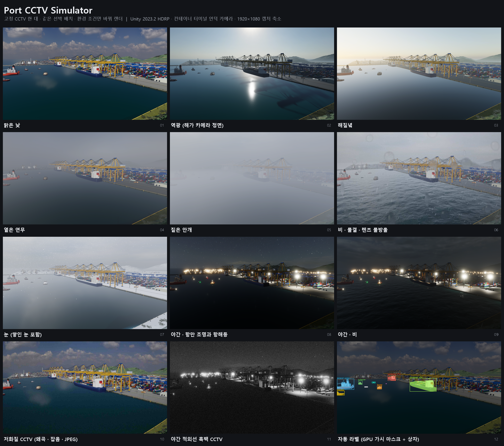

# Port CCTV Simulator

항만 고정 CCTV 시점의 선박 장면을 만들고, RGB 이미지와 잠정 라벨(마스크·상자·메타데이터)을 생성하는 Unity/HDRP 시뮬레이터입니다.

A Unity/HDRP simulator that builds harbour scenes seen from fixed port CCTV cameras and exports RGB images with provisional labels (instance masks, boxes, metadata).



## 기능

- 항만 지도 3종(컨테이너 항만, 어항, 마리나)과 지도별 고정 CCTV 카메라
- 선종 28종 배치(자동 배치 또는 CCTV 화면 클릭 배치), 계류·자유 항해, 선체 색 무작위화
- 날씨·시간대: 맑음, 흐림, 연무, 비, 눈, 역광, 황혼, 야간(항해등·항만 조명)
- CCTV 화질 열화: 렌즈 왜곡, 흐림, 흔들림, 센서 노이즈, 비네팅, IR 흑백, JPEG, 렌즈 물방울
- 라벨: 렌더 깊이 기반 GPU 가시 마스크(기본), CPU 광선 마스크(비교용), 객체별 상자·메타데이터, YOLO 형식 파일
- JSON 시나리오 저장·불러오기, 배치 캡처와 이어하기, 회귀 검사 세트

## 바로 실행하기 (Windows 빌드)

Unity 없이 실행하려면 [Releases](https://github.com/bootaeng/PortCCTVSimulator/releases/latest)에서 `PortCCTVSimulator_win64.7z`(약 870 MB)를 내려받아 [7-Zip](https://www.7-zip.org/)으로 압축을 풀고 `PortCCTVSimulator.exe`를 실행합니다. 압축 안의 `README_RUN.txt`에 명령줄 사용법이 있습니다.

To run without Unity, download `PortCCTVSimulator_win64.7z` from [Releases](https://github.com/bootaeng/PortCCTVSimulator/releases/latest), extract it and start `PortCCTVSimulator.exe`.

## 요구 사항

- Unity 2023.2.22f1
- HDRP 16.0.6, glTFast 6.15.1 (패키지는 `Packages/manifest.json`)
- Windows, Direct3D 11/12

## 소스에서 실행·빌드

1. Unity Hub에서 이 폴더를 프로젝트로 엽니다.
2. 처음 열 때 초기 구성을 실행합니다.

   ```
   Unity.exe -batchmode -projectPath <이 폴더> -executeMethod PortCCTV.EditorTools.ProjectBootstrap.RunBatch -logFile Logs/bootstrap.log
   ```

3. `Assets/PortCCTVSimulator/Scenes`의 장면을 열고 Play 하거나, Windows 실행 파일로 빌드합니다.

실행 파일 명령줄 예:

```
PortCCTVSimulator.exe -scenario Scenarios/example_multi_three_B.json -capture Captures/my_capture -quit
PortCCTVSimulator.exe -batch Scenarios/<set>/jobs.json -quit
```

예제 시나리오는 `Scenarios/example_*.json`에 있습니다.

